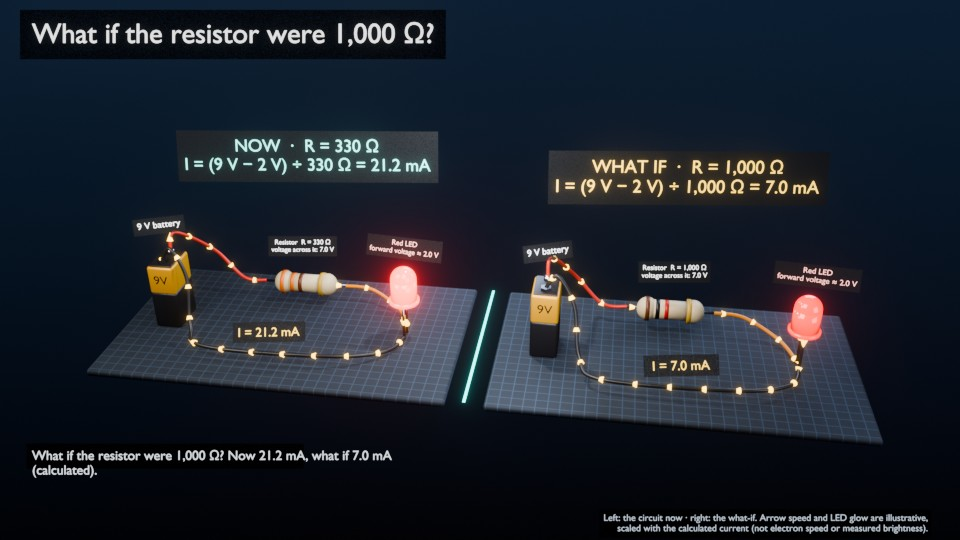

# TinyDirector: Poyo, a 3D tutor you can talk to (HackUTD 2026)



Ask Poyo a question out loud and Blender becomes the classroom. **NVIDIA Nemotron** decides what to do with every
request, builds or changes a real 3D scene, and explains it while the camera follows along. Nothing is
taken on the model's word. Numbers come from calculation modules, every scene change is checked against what
Blender reports back, and explanations that state a wrong number or a known misconception are rejected and rewritten.

What you can do today:

- **"Why does an LED need a resistor?"** builds a live circuit. You can change the resistor ("make it 1,000 ohms",
  "increase the resistance") and the same Blender objects update: labels, color bands, the speed of the current
  arrows, the LED glow.
- **What-If Lab.** "Show me what's happening inside this circuit" gives a narrated camera tour with calculated
  measurements. "Compare what happens with 1,000 ohms" puts a what-if copy side by side with the untouched original.
- **New electronics lessons on demand.** Ask about BJTs vs MOSFETs, voltage dividers, Ohm's law and so on, and an
  agent team designs, builds and verifies a brand-new 3D lesson.
- **Spot the Scam.** A cybersecurity lesson for the T-Mobile challenge: a 3D phone with a fictional scam text,
  its warning signs, your choice, both outcomes as labeled simulations, and practical next steps.
- **Knowledge base.** A SQLite knowledge base of concepts, cited facts and common misconceptions grounds every
  answer, and a knowledge map lights up as you learn.

## How it works

```
 you (voice or text)                                    Blender (the stage)
        │                                                        ▲   │ read-back: what is really
        ▼                                                        │   ▼ on screen, every value
  Poyo window ──► Nemotron picks ONE tool ──► calculators /   ──► bridge ──► checks: the scene must match
  (browser)       (validated JSON, 1 retry)   lesson agents       (files)     the request and the calculation
        ▲                                                                              │
        └──── Poyo speaks the checked explanation; the camera follows each sentence ◄──┘
```

- **Nemotron** (`nvidia/nemotron-3.5-super-vl-120b-a12b` via build.nvidia.com) does three jobs:
  - chooses the tool for each turn from the learner's own words and Blender's live scene;
  - writes the explanations;
  - directs new lessons and checks renders with its vision model.
- **Model output is data, never code.**
  - Tool calls and lesson specs are validated against JSON schemas, with at most one corrective retry.
  - The only generated code, the lesson builder's, runs in an AST-allowlisted sandbox inside a separate
    headless Blender.
- **Blender is the source of truth.** Every turn starts by asking Blender what it is showing. The objects are
  tracked by id, so "change the resistor" updates the same objects instead of rebuilding.
- **Honest labels.** Anything mocked or simulated is labeled MOCK / SIMULATED. Retrieved facts are shown as
  *cited*, not *verified*. The scam detector is labeled a heuristic prototype.

## Run it

Needs Python 3.10+ (developed on 3.12), Blender (developed on 5.2), an NVIDIA API key (`nvapi-...`) and, for voice and the lesson builder, an
OpenAI key.

**Linux / macOS**
```bash
python3 -m venv .venv && source .venv/bin/activate
pip install -r director/requirements.txt
cp .env.example .env                      # add NVIDIA_API_KEY (and OPENAI_API_KEY for voice + builder)
python -m director.studio --blender       # Blender stage + the Poyo window at http://127.0.0.1:8765
```

**Windows (PowerShell)**
```powershell
python -m venv .venv; .venv\Scripts\activate
pip install -r director\requirements.txt
copy .env.example .env                    # then add your keys
$env:BLENDER = "C:\Program Files\Blender Foundation\Blender 5.2\blender.exe"   # if blender is not on PATH
python -m director.studio --blender
```

Put Blender and the Poyo window side by side. Click the mic (or hold Space) and say:

> "Poyo, teach me why LEDs need resistors." · "What if I make the resistor 1,000 ohms?" · "Why did it get dimmer?" ·
> "Show me what's happening inside this circuit." · "Compare what happens if I use 1,000 ohms." ·
> "How does a voltage divider work?" · "Teach me how to recognize scam texts." · "What if I follow the link?"

You can also type in the drawer's Type tab. To run offline with no keys and no Blender, use
`python -m director.studio --mock --simulate`; everything is then labeled MOCK / SIMULATED.

## Check it

```bash
python -m pytest director/tests -q                                         # offline test suite
blender -b --factory-startup --python blender_engine/circuit_check.py     # Blender-side self-tests (also:
                                                                           #   direction_, compare_, scam_check.py)
python -m director.dev.whatif_e2e        # live end to end: Nemotron + headless Blender on a private bridge folder
python -m director.dev.scam_e2e          #   (add --mock for the offline model); also voice_e2e, circuit_e2e
```

## Repository

| Path | What it is |
|---|---|
| `director/` | everything that is not Blender: the tutor (`tutor.py`), the Poyo server and studio (`server.py`, `studio.py`), voice (`voice.py`), stage direction cues (`stage.py`) |
| `director/circuit/` | the LED tutor: tool selection + explanation agent, calculation model, read-back checks |
| `director/lesson/` | multi-agent lessons: Nemotron director, calculators, OpenAI builder, sandboxed build, verifier |
| `director/knowledge/` | the SQLite knowledge base (`seed.json` is the reviewed source) |
| `director/scam/` | Spot the Scam: fictional scenario, heuristic detector + toy evaluation, lesson turns, checks |
| `blender_engine/` | runs inside Blender: the worker, circuit, comparison, camera direction, scam scene, lesson loader |
| `frontend/` | the Poyo companion page (Poyo's art is `poyo.svg`) |
| `shared/schema/` | JSON contracts between the director and Blender |
| `docs/` | write-ups, renders and saved `.blend` scenes for each feature |

Detailed docs:
- [STUDIO.md](docs/STUDIO.md): the Poyo studio and voice
- [CIRCUIT_TUTOR.md](docs/CIRCUIT_TUTOR.md): the LED tutor
- [WHATIF.md](docs/WHATIF.md): the What-If Lab
- [MULTI_AGENT.md](docs/MULTI_AGENT.md): multi-agent lessons
- [KNOWLEDGE.md](docs/KNOWLEDGE.md): the knowledge base
- [SCAM_LESSON.md](docs/SCAM_LESSON.md): Spot the Scam

## Where it started

TinyDirector began as "talk to Blender": Nemotron turned requests like "create a red mug next to a tree, then make
only the mug blue" into validated scene plans. That scene director still works:

```bash
blender --python blender_engine/worker.py
python -m director.cli --send --text "Create a red cube beside a cabin."
```

See [PHASE1.md](docs/PHASE1.md) and [PHASE2.md](docs/PHASE2.md) (CC0 asset library and polished renders).
