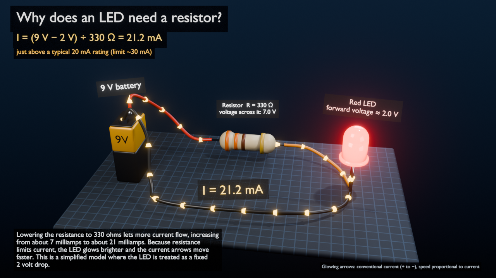

# TinyDirector (HackUTD 2026)

Talk to Blender. NVIDIA Nemotron reads the real scene, plans a constrained set of tool actions as JSON, the plan is validated, Blender executes it, and the resulting scene state feeds the next request. So "turn just the mug blue" changes the mug and nothing else.

- `director/` — Nemotron planner, validator, CLI, inbox/outbox bridge ([director/README.md](director/README.md))
- `shared/schema/` — the plan + result contract; `shared/ENGINE_CONTRACT.md` — what the Blender side implements
- `blender_engine/` — Blender executor: worker, procedural assets, Windows launcher ([blender_engine/README.md](blender_engine/README.md))

Quick start: `python -m pytest director/tests -q`, then see director/README.md.

## Demo in two terminals (Windows)
```powershell
powershell -ExecutionPolicy Bypass -File blender_engine\run_blender.ps1     # terminal 1 (opens Blender)
python -m director.cli --send --text "Create a red mug next to a tree" --trace   # terminal 2
python -m director.cli --send --text "Change only the mug to blue" --trace
```

## Demo in two terminals (Linux)
```bash
blender --python blender_engine/worker.py                                      # terminal 1
source .venv/bin/activate                                                      # terminal 2
python -m director.cli --send --text "Create a red cube beside a cabin." --trace
python -m director.cli --send --text "Change the red cube to blue." --trace
python -m director.cli --send --text "Add a tree and make the cube bounce three times." --trace
```
Press Space in Blender's viewport to play. `docs/phase1_demo.blend` is a saved result of exactly these three
prompts (regenerate with `python -m director.dev.phase1_e2e`). Phase 1 notes: [docs/PHASE1.md](docs/PHASE1.md).

## Asset library + polished renders (Phase 2)


CC0 Poly Haven assets and stylized library meshes, used through the same Nemotron plans. See [docs/PHASE2.md](docs/PHASE2.md) and [docs/ASSETS.md](docs/ASSETS.md).

## Interactive circuit tutor (Phase 3)


"Why does an LED need a resistor?": Nemotron picks the tool and explains, a small calculation module produces
every number, and Blender shows the same circuit updating (labels, resistor color bands, current-flow speed,
LED glow). Run `blender --python blender_engine/worker.py`, then `python -m director.tutor`.
See [docs/CIRCUIT_TUTOR.md](docs/CIRCUIT_TUTOR.md).

## Poyo studio: Blender is the stage, talk to Poyo
`python -m director.studio --blender` starts Blender as a full-window stage (no panels, through the lesson camera)
and the Poyo companion at http://127.0.0.1:8765. Put the two windows side by side, click the mic (or hold Space) and
say "Poyo, teach me why LEDs need resistors." Poyo answers out loud, and the camera follows what it is talking about.
Follow up with "What if I make the resistor 1,000 ohms?" (the same Blender objects are updated) and "Why did it get
dimmer?" (explained without touching the scene). Voice uses OpenAI speech-to-text/text-to-speech (`OPENAI_API_KEY`);
Nemotron still decides every turn. The Type tab in the details drawer is the text fallback. Offline:
`python -m director.studio --mock --simulate` (labeled MOCK / SIMULATED). See [docs/STUDIO.md](docs/STUDIO.md).

**What-If Lab.** Say "Poyo, show me what's happening inside this circuit" for a camera tour with calculated
callouts, or "Compare what happens if I increase the resistor to 1,000 ohms" for a side-by-side what-if copy
(the original stays untouched; "go back to the original" removes it). See [docs/WHATIF.md](docs/WHATIF.md).

**Spot the Scam.** One cybersecurity lesson for the T-Mobile scam challenge. Say "Poyo, teach me how to recognize scam texts." A 3D phone shows a FICTIONAL suspicious text. Poyo walks through its warning signs (found by a labeled heuristic prototype, not a trained model), asks what you would do, and shows both choices as hypothetical simulations side by side. It ends with practical steps: verify in the official app, report the text to 7726, and recover if you already shared something. See [docs/SCAM_LESSON.md](docs/SCAM_LESSON.md).

## Knowledge base
A SQLite knowledge base (`director/knowledge/`, built from the reviewed `seed.json`) holds concepts, prerequisites,
cited facts, common misconceptions, demo templates and links to the calculators and verifiers. Every turn retrieves
what is relevant for Nemotron, and the Poyo page draws the same database as a knowledge map that lights up as
concepts are discussed. Retrieval is not verification: numbers are still checked against the calculators, and each
answer says which facts were calculator-verified and which are only cited. `python -m director.knowledge query "..."`;
see [docs/KNOWLEDGE.md](docs/KNOWLEDGE.md).

## Multi-agent lessons
Ask about another electronics idea ("Why would someone use a BJT over a MOSFET?") and an agent team builds a new
lesson. Nemotron directs (lesson spec), calculators produce every number, an OpenAI builder writes sandboxed
Blender toolkit code, and a verifier checks Blender's read-back plus a Nemotron vision pass. Only a verified build
is loaded into your scene. `python -m director.lesson --text "..." --send`; see [docs/MULTI_AGENT.md](docs/MULTI_AGENT.md).
