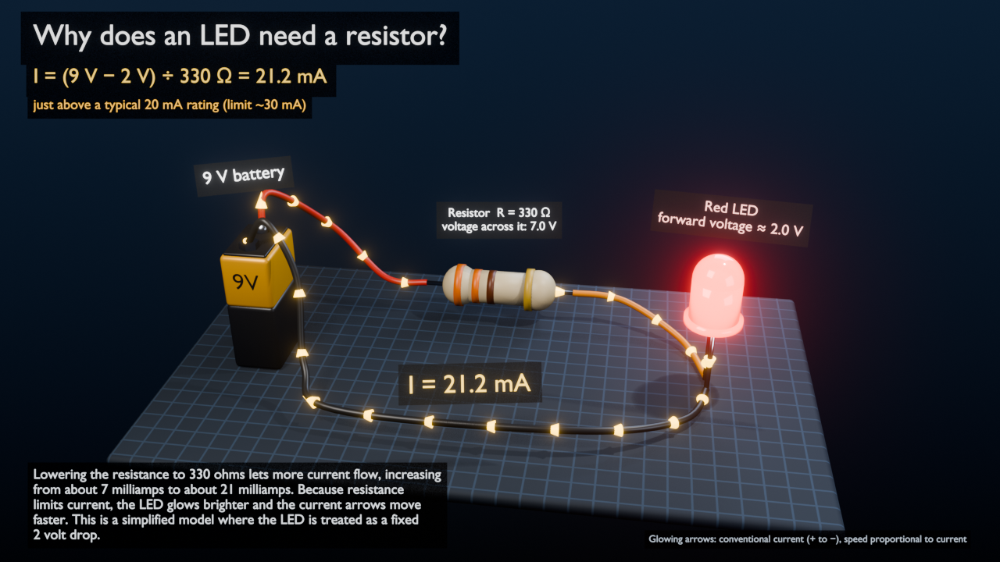

# Circuit tutor: "Why does an LED need a resistor?"



The lesson runs on one interactive 3D circuit: a 9 V battery, a resistor and a red LED. You ask questions or
request changes in plain English, and the **same** Blender scene updates. Nemotron understands the request, picks a
tool and explains the result. A small calculation module produces every number.

## Run it
```bash
blender --python blender_engine/worker.py          # terminal 1: Blender + worker (GUI)
python -m director.tutor                           # terminal 2: talk to the tutor
```
Try these:
- "Teach me why LEDs need resistors."
- "Change the resistor to 1,000 ohms."
- "Put it back to 330 ohms."
- "Why did the LED get dimmer?"
- "What if I remove the resistor?"

After a lesson is built, the Blender viewport switches to the lesson camera and starts playback. To change one
thing at a time, use `--text "..."` for a single turn. To run offline, use `--simulate --mock`; output is labeled
SIMULATED and MOCK.

## How a turn works
```
user text
  -> inspect Blender: the circuit it actually shows (custom props on the objects)    [source of truth]
  -> Nemotron: ONE tool call, JSON {"tool", "args"}; validated, max 1 corrective retry
       teach_led_resistor | set_resistance{resistance_ohm} | explain{question} | clarify{message}
  -> director/circuit/model.py: I = (V_source - V_LED) / R                           [the only source of numbers]
  -> Nemotron: 2-3 sentence explanation of those FACTS
       every number is checked against the facts (unit-aware, rounding allowed); 1 retry, then a template
  -> circuit_request_v1 (build | update) -> Blender worker -> blender_engine/circuit.py
  -> read-back checked against the calculation (director/circuit/check.py)
```
Nemotron never computes a current. If it writes "3 mA" or invents a rating, the explanation is rejected.
A value the model can't show, such as "1234 ohms" (not a standard 2-digit resistor value), is declined, and the
scene is left unchanged.

## Stage 1 audit: what was reused, what was added
| Existing piece | How the lesson uses it |
|---|---|
| File bridge, worker timer loop, `TD_SHARED_DIR` | Unchanged. A new request `kind: "circuit"` sits beside `inspect` and plans. |
| Scene inspection before every request | Inspections now include a `circuit` read-back block. |
| `scene_result_v1` result format | Reused as is. The circuit read-back is an extra optional field. **No schema change.** |
| Stable IDs and read-back checks (`postcheck.py` idea) | Same idea: `circuit/check.py` compares Blender's data with the calculation. |
| Nemotron client, JSON extraction, 1-retry rule, trace | Reused (`planner.extract_json`, `Trace`, `NemotronClient`). |
| `scene_plan_v1` operations (add/modify/animate/bounce) | Not used: they can't express labels, flow speed or glow. Left untouched. |
| Asset library / Blender MCP | Not needed for this lesson. Untouched (MCP was never wired into the runtime). |

Smallest additions:
- **Bridge:** one additive request schema (`circuit_request_v1.json`).
- **Engine:** one engine module (`blender_engine/circuit.py`), plus about 40 lines in `worker.py`.
- **Director:** one package (`director/circuit/`) and one CLI (`director/tutor.py`).

## The model (director/circuit/model.py)
- Topology: one series loop. Battery → resistor → LED → battery.
- Defaults:
  - battery: 9 V
  - resistor: 330 Ω
  - LED: red, forward voltage 2 V
- Formula:
  - I = (V_source − V_LED) / R when V_source > V_LED.
  - Otherwise I = 0 (LED off).
- Results (unit tests):
  - 330 Ω → 21.2 mA
  - 1,000 Ω → 7.0 mA
- Resistor values: 10 Ω to 1 MΩ, standard 2-significant-digit values only, so the 4-band color code
  (digit, digit, multiplier, gold) is exact. 330 Ω = orange-orange-brown, 1 kΩ = brown-black-red.
- Ratings, which are illustrative typical values for a 5 mm LED, not a specific datasheet:
  - ≤ 20 mA "within rating"
  - ≤ 30 mA "just above"
  - above that, "too much"

**Assumptions and limitations:** this is not a circuit solver.
- The battery is ideal, with no internal resistance.
- The wires have zero resistance.
- The resistor is exact.
- The LED is a fixed 2 V drop. A real LED's voltage rises a little with current, along an exponential curve.
- It is DC only, with no transients or heating.
- With R = 0 the model has no answer: it predicts unlimited current. That point is the lesson ("nothing limits the
  current"), but the model cannot say what really happens (battery internal resistance, the LED failing).

## What Blender shows (blender_engine/circuit.py)
All objects are persistent and keep stable IDs. Each Blender object name equals its ID, and the custom props
`circuit_id` and `circuit_uid` carry the same identity.
- **Components:** `board_1`, `battery_1`, `resistor_1`, `led_1`, `wire_1`, `wire_2`, `wire_3`, `flow_1`.
- **Labels:** `label_*`. Component labels sit next to their parts. The title, equation, rating, caption and legend
  are attached to the camera.

**Build animation** (288 frames at 24 fps):
- the battery, resistor and LED pop in;
- the wires grow;
- the circuit "closes" at frame 80;
- current markers and LED glow ramp up by frame 92;
- the labels appear.

**What an `update` changes:** it rewrites values on the existing objects only. The read-back proves the IDs and
UIDs are unchanged and nothing moved. It updates:
- the resistor label and color bands
- the current label
- the equation and rating
- the marker speed
- the LED glow and its light
- the caption (Nemotron's explanation)

**Illustrative mappings**, labeled in the scene as such:
| Shown | Mapping | 330 Ω | 1,000 Ω |
|---|---|---|---|
| Current markers | **Conventional** current (+ → resistor → LED → −), not electrons. Speed ∝ I (one lap = 96 frames at 20 mA). | 90.5 frames/lap | 274.3 frames/lap (3.03× slower) |
| LED glow | Emission ∝ I (0.3 per mA), light 4 W per mA, clamped | 6.36 | 2.10 |

Real charge drift is millimetres per second. The marker speed is a visual analogy for "how much current".

## Results (actual runs, 2026-11-07, Blender 5.2.3, CPU)
| Test | Result |
|---|---|
| `python -m pytest director/tests -q` | **117 passed** (73 existing + 44 new: 330 Ω→21.2 mA, 1 kΩ→7.0 mA, bands, schema, tool validation and retry, number guard, 3-turn flow on the SIMULATED engine) |
| `blender -b --factory-startup --python blender_engine/circuit_check.py` | ALL PASSED: build 10/10, update to 1 kΩ 12/12, back to 330 Ω 12/12; 17 objects keep their UIDs |
| `python -m director.dev.circuit_e2e` (**live Nemotron** + real Blender) | **4 of 4 runs ALL PASSED** (3 prompts each, same scene) |
| Varied phrasings, live Nemotron (SIMULATED engine) | 9/9 correct: "1k" → 1000; "why dimmer?" and "remove the resistor?" → explain with no change; "1234 ohm" → declined, scene unchanged; battery and PCB requests → clarify; "try 470" → 14.9 mA, "about 15 milliamps" |
| Regression: `headless_check`, `phase1_check`, `phase1_e2e --mock` | all passed |

Recorded live run (`experiments/out/circuit_lesson_states.json` stores the full before/after read-back of every step):
| Step | Nemotron tool | Blender before → after | Current label | Time |
|---|---|---|---|---|
| "Teach me why LEDs need resistors." | `teach_led_resistor {}` | no lesson → R=330 (v1) | I = 21.2 mA | ~4 s |
| "Change the resistor to 1,000 ohms." | `set_resistance {1000}` | R=330 → R=1000 (v2) | I = 7.0 mA | ~3 s |
| "Put it back to 330 ohms." | `set_resistance {330}` | R=1000 → R=330 (v3) | I = 21.2 mA | ~3 s |

Example live explanation (step 2): *"Changing the resistor to 1,000 ohms increases the resistance, which limits the
current. The current drops from about 21 milliamps to about 7 milliamps, so the LED glows dimmer and the current
arrows move slower. This is a simplified model where the LED is treated as a fixed 2 volt drop."*

Artifacts:
- `docs/circuit/circuit_lesson.blend`: the scene after the three prompts. Open it and press Space.
- `docs/circuit/preview.png`: a render at frame 200.
- `docs/circuit/step1-3.jpg`: the worker's snapshot after each prompt.

## Known limitations
- One lesson and one topology, by design. The battery, the LED and the wiring are fixed. Nemotron says so through
  `clarify`.
- Changing a value updates the scene instantly. There is no animated before → after transition yet.
- `explain` turns re-send the scene with only the caption changed. That bumps the scene version.
- The GUI conveniences (switching to the camera view and starting playback) are best-effort. They are not covered
  by the headless tests.
- The explanation number check verifies numbers and their kind (mA, V, Ω, times), not every claim in the sentence.
  For example, it can't tell "dimmer" from "brighter". The current label, which is the authoritative number on
  screen, is checked exactly.

## Next logical steps
1. An animated what-if transition: markers slow down while the LED fades over about 1 s, plus a before/after
   split view.
2. More single-variable what-ifs that the model already supports: battery voltage, LED color (forward voltage
   1.8–3.2 V). These need a small tool and schema addition, and team agreement.
3. Make the "no resistor" moment visual: a pre-rendered "LED burns out" clip, clearly labeled as illustrative.
4. Point the Nemotron VL visual check at the lesson snapshot ("is the LED lit? are the labels readable?").
5. Narration (TTS) and a minimal chat panel, once the lesson content is locked.
