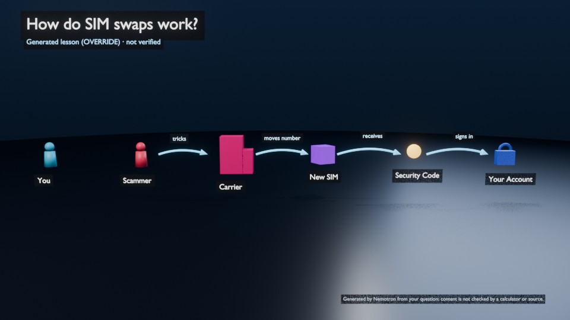

# OVERRIDE: a generated lesson for any question

Poyo's prepared lessons (the LED circuit, the What-If Lab, generated electronics lessons, Spot the Scam) are checked
against calculators, scenarios and read-backs. OVERRIDE is the way off those tracks. Say the keyword and ask about
anything:

> "Poyo, **override**: how do SIM swaps work?" · "Override. How does the water cycle work?" ·
> "How do vaccines work, override" · "Override." (then ask the question in the next turn)

Nemotron designs a small 3D explainer for your question, Blender builds it, and Poyo narrates it while the camera
visits each part. Follow-up questions ("why does that matter?", "explain that in simpler terms") are answered from
that lesson. Asking for a prepared lesson ("teach me why LEDs need resistors") replaces it.



```bash
python -m director.studio --blender               # the normal Poyo studio: just say "override" first
python -m director.tutor --text "Override: how do SIM swaps work?"            # one turn (Blender worker running)
python -m director.dev.explainer_e2e [--mock]    # end to end: Nemotron (or MOCK) + headless Blender, private bridge
blender -b --factory-startup --python blender_engine/explainer_check.py [-- --render DIR --save FILE]
```

## How it works

```
"override: <question>" ──► Nemotron SCENE_DIRECTOR ──► spec (JSON data) ──► validate + lint ──► explainer_request_v1
   (keyword, not the           (+ knowledge base       │  1 corrective retry,     │                     │
    tool selector)              facts, conversation)   │  else nothing is built   ▼                     ▼
                                                       └── or {"refuse": ...}   Blender builds it ──► read-back checked
                                                                                (fixed shapes/layouts)   Poyo narrates
```

1. **Keyword.** `tutor.override_question` recognizes "override" at the start (after "Poyo," or "hey Poyo") or at the
   end of the request; "over-ride" / "over ride" also work. It skips the tool selector: the learner asked for a
   generated lesson, so no model gets to second-guess the keyword. Without the keyword, the normal tutor runs, and
   for an off-topic question its `clarify` reply now tells the learner they can say "override".
2. **Design** (`director/explainer/agent.py`). Nemotron writes ONE JSON object: a title, a one-sentence summary, a
   layout, 2-7 elements, arrows between them, 2-6 narration steps (each with the element the camera should visit),
   key points and what the diagram simplifies. Its prompt gets the knowledge base's matching facts (background, not
   verification) and the conversation so far. For unsafe requests it answers `{"refuse": "..."}` and nothing is
   built. For scams, fraud and hacking it explains how they work at a high level and how to protect yourself, never
   how to commit them.
3. **Validation** (`director/explainer/spec.py`, `shared/schema/explainer_request_v1.json`, additive):
   - schema: shapes from a fixed list of 28, layouts `row` / `flow` / `cycle` / `hub` / `stack` / `grid`,
     motions `none` / `spin` / `bob` / `pulse`, `#RRGGBB` colors, length limits;
   - lint: unique ids and labels, arrows between existing elements, narration focus = an element or `overview`,
     narration at most 130 words, no web addresses, phone numbers or markdown anywhere;
   - the knowledge base's misconception check on the narration and key points;
   - conversation rules: no greeting or self-introduction after the first turn, no copied sentences.

   One corrective retry, then the turn fails and nothing is built.
4. **Build** (`blender_engine/explainer.py`). A deterministic builder turns the spec into a scene:
   - shapes: the 13 procedural assets plus 15 simple custom shapes;
   - per-layout placement, curved arrows with their labels on whichever side is clear;
   - motion keyframes, a camera fitted to the content;
   - a HUD with the title, a **"Generated lesson (OVERRIDE) · not verified"** banner and a legend.

   The spec is data, never code. Blender's own validation refuses unknown shapes before anything is built.
5. **Read-back checks** (`director/explainer/check.py`), measured from Blender's data:
   - every element built with its shape and its exact label;
   - every arrow drawn between the right elements with the right words;
   - motion keyed exactly where asked;
   - the title and the not-verified labels on screen;
   - the stored spec equals the one sent.

   Layout (every element inside the camera frame, no overlaps between elements and arrow labels) is measured from
   the camera's home framing and reported as a warning.
6. **Narration.** The reply is the design's narration. Each step is a stage cue: the browser plays them in sync with
   Poyo's voice and moves Blender's camera to that element (amber ring) or back to the overview.
7. **Follow-ups** (`lesson.explain_question`). While the lesson is on stage, the tool selector sees it in
   `<circuit_state>` and picks `explain`. Poyo answers from the spec that Blender stored and reads back, with the
   normal explanation checks (numbers must appear in the lesson, misconceptions, conversation rules, 1 retry). The
   fallback is the lesson's key points, skipping anything Poyo already said. The camera follows the elements each
   sentence names.

## Honest labels

- Everything in a generated lesson is **model-written and not verified**. This is stated:
  - on screen (banner + legend);
  - in the Poyo window (chips "Generated (OVERRIDE)" · "not verified", grounding "content not verified");
  - in the activity feed ("consistent with the generated lesson; not verified").

  Only the scene's structure is machine-checked: what Blender shows is exactly what was designed.
- Knowledge-base facts given to the designer are *retrieved*, not verified.
- With `--mock`, the offline MOCK model writes a fixed 3-element design titled "MOCK lesson: ..." with a
  "MOCK lesson" banner.

## Conversation memory (all lessons)

Poyo used to re-introduce itself ("Hi, I'm Poyo, your AI tutor") on the 2nd or 3rd prompt and repeat the same
lines. Now:
- every explanation sees the last turns (`CONVERSATION` in `director/circuit/agent.py`, context only, never a source
  of numbers);
- `continuity_check` rejects a greeting or self-introduction after the first turn, and a reply that copies an
  earlier reply's opening or closing sentence (or two or more sentences);
- one retry, then the template. The OVERRIDE template skips what was already said.

## Verified (2026-11-08)

- **Offline tests.** `python -m pytest director/tests -q`: 278 passed, 12 of them in `test_explainer.py`:
  schema = Blender's lists, lint, the keyword, MOCK + SIMULATED turns, refusal, one retry, read-back checks,
  continuity.
- **Blender self-tests.** `explainer_check` builds every layout plus a recorded live design (a cycle with a chord
  through the middle) and checks labels, framing, overlaps, motion, arrows, camera focus and refusal: ALL PASSED.
  `scam_check`, `direction_check`, `compare_check` and `circuit_check`: ALL PASSED.
- **Live end to end.** `explainer_e2e` (Nemotron + headless Blender), 5 turns: ALL PASSED.
  - SIM swaps (flow, 6 elements);
  - two follow-ups in Nemotron's own words, with no greeting and no repeated lines;
  - the water cycle (cycle);
  - the LED lesson replacing it.

  Record: `docs/override/live_run.json`, with renders `sim_swap.jpg`, `focus_scammer.jpg` (the camera on one
  narration stop) and `water_cycle.jpg`.
- **Regressions after the change**, all live (Nemotron + headless Blender): `scam_e2e` and `whatif_e2e`,
  ALL PASSED.
- **Not yet verified:** OVERRIDE by real microphone in the studio.
