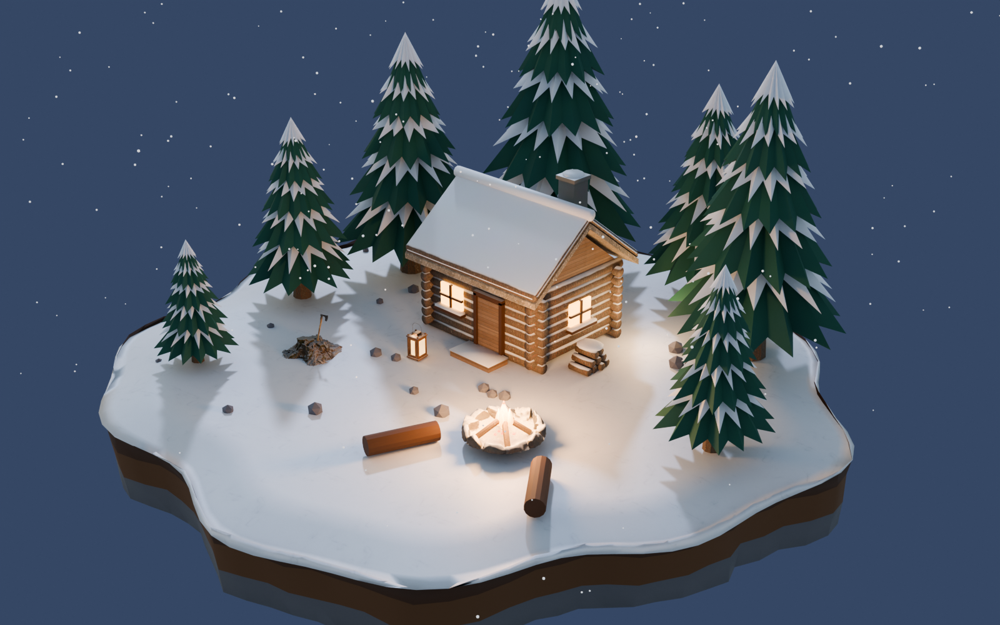
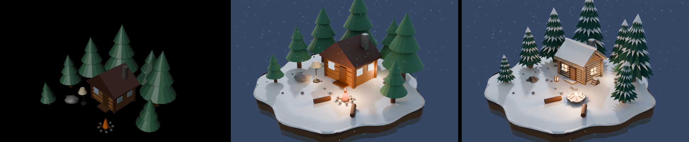

# Phase 2: Blender MCP evaluation, CC0 assets, and a polished winter diorama



The image above is `experiments/winter_diorama.py --variant library`. Every object in it was placed with ordinary `scene_plan_v1` operations through `blender_engine/engine.py`.

## Result


Left to right:
1. Today's pipeline output: procedural assets, Workbench snapshot.
2. Same procedural assets with the new staging: diorama base, dusk HDRI, warm practical lights, depth of field, Cycles.
3. Library assets plus the new staging.

**Blind A/B check by live Nemotron VL.** Each pair was shown in both orders, so position bias cancels out:

| Comparison | Winner (both orders) | Scores |
|---|---|---|
| procedural + staging vs **library + staging** | library + staging, "clear" | 6 vs 8 |
| current pipeline vs **library + staging** | library + staging, "large"/"clear" | 4–5 vs 8–9 |

**Honest read:** staging (lighting, base, camera) is the largest single gain, and it is cheap. The library assets add the winter-specific detail the judge called out: snow-capped pines, real log texture, a convincing fire pit.

## Blender MCP (ahujasid/mcp-for-blender v2.2.7, MIT): findings
- **How it works:** a Blender add-on opens a socket on `localhost:9876` (plain JSON, no auth), and an MCP server (`uvx mcp-for-blender`) exposes tools to an AI client. It needs a GUI Blender, because the add-on runs on Blender timers.
- **Tools:**
  - scene and object info, viewport capture
  - `search_assets` / `import_asset`: Poly Haven (CC0), Sketchfab (per-model license, token required), Poly Pizza
  - `generate_3d`: paid providers (Meshy, Hunyuan3D, Tripo, Rodin)
  - `execute_blender_code`: **arbitrary Python**. It's off-limits by default, and the optional AST allowlist (`BLENDER_MCP_SAFE_MODE=1`) only guards the MCP path; the socket itself accepts raw code from any local process.
- **Telemetry:** an anonymous usage record (tool name, timing, versions, install ID) is sent to Supabase **by default**. Prompts, code and screenshots are only sent if you opt in. Set `DISABLE_TELEMETRY=true` to turn all of it off.
- **Coexistence:** it does not conflict with our worker (socket vs. files), even inside the same Blender.
- **This Claude Code session:** not feasible mid-session. MCP servers load at session start, `uv` isn't installed, and it needs its own GUI Blender. The same work was done with reviewed Blender Python and direct Poly Haven API calls. That is equivalent to its `execute_blender_code` and Poly Haven tools, but reproducible and checked into git.

To try it in a later session, in a **separate test Blender, never the demo scene**:
```bash
pipx install uv   # or: curl -LsSf https://astral.sh/uv/install.sh | sh
claude mcp add blender --scope local -e DISABLE_TELEMETRY=true -e BLENDER_MCP_SAFE_MODE=1 -- uvx mcp-for-blender
# then in Blender: install addon.py from the repo, N-panel -> MCP for Blender -> Connect; restart Claude Code
```
Save the scene before every `execute_blender_code` call (the README says the same), and keep `generate_3d` disabled unless paid use is approved.

**Recommendation:**
- Use MCP as an optional *authoring* tool for humans and Claude, not inside the runtime.
- The runtime keeps Nemotron → validated JSON → worker, and imported assets enter it via the catalog, the way this phase did it.

## What changed
- **Asset library:**
  - `assets/catalog.json`: IDs, sources, licenses, parameters
  - `assets/fetch.py`: stdlib downloader, MD5 check, writes a manifest per asset
  - `assets/build_library.py`: one mesh per asset, tint node, snow shader, images packed
  - docs: [ASSETS.md](ASSETS.md)
- **Engine** (`blender_engine/library.py` plus small hooks in `engine.py`):
  - `TD_ASSET_LIBRARY=1` or `worker.py -- --library` turns it on; it falls back to procedural assets when the library is missing
  - `color` tints textured assets
  - read-back adds a `library` field
- **Planner prompt:** set `color` only when the user names one. The campfire's `color` is the flame color. Without this, Nemotron tinted the flame brown.
- **Experiments:**
  - `experiments/winter_diorama.py`: three variants
  - `director/dev/library_e2e.py`: live pipeline using the library
- **No JSON contract change. No new runtime LLM.** The Phase 1 checks still pass.

## Test results (actual runs)
| Test | Result |
|---|---|
| `python -m pytest director/tests -q` | 73 passed |
| `headless_check.py`, `phase1_check.py` (library off) | all passed |
| `python -m director.dev.phase1_e2e` (live Nemotron) | all passed (regression) |
| `python -m director.dev.library_e2e` (live Nemotron, library on) | all passed: imported `td_cabin_winter`, `td_pine_snowy` ×2, `ph_fire_pit_lit`; cabin tinted red; fire pit moved +1 m; fire pit bounced twice; trees untouched; library IDs kept across all edits |

## Reproduce
```bash
python assets/fetch.py
blender -b --factory-startup --python assets/build_library.py
blender -b --factory-startup --python experiments/winter_diorama.py -- --variant library      # ~2.5 min on 12 CPU cores
python -m director.dev.library_e2e                                                          # live Nemotron
blender --python blender_engine/worker.py -- --library     # interactive: your prompts now use library assets
```
Outputs go to `experiments/out/` (gitignored). `diorama_library_polished.blend` is self-contained, with images packed (25 MB).

## Limitations
- The library only re-skins existing asset names (cabin, tree, campfire, rock, lamp). Adding new names, such as `lantern` or `stump`, would be an additive schema change for the team to agree on.
- The `rock` slot now renders as a stump with an axe. That works in a winter scene but is semantically odd elsewhere. It needs either a dedicated `stump` name or a library "theme" switch.
- The staging (diorama base, HDRI, lights, camera, Cycles) lives in the experiment script. The worker's own snapshot is still Workbench, so Nemotron's visual check sees flat renders. The next step is a `scene_style` setting or a render step that applies the same staging.
- Cycles on CPU takes about 2.3 minutes for 1600×1000 at 128 samples. That's fine for final renders, too slow per edit.
- The stump keeps its scanned dirt mound, which is a slightly realistic note in a stylized scene.
- The library `.blend` files are 1.4–6.8 MB each because images are packed. That's fine locally; they are not committed.
